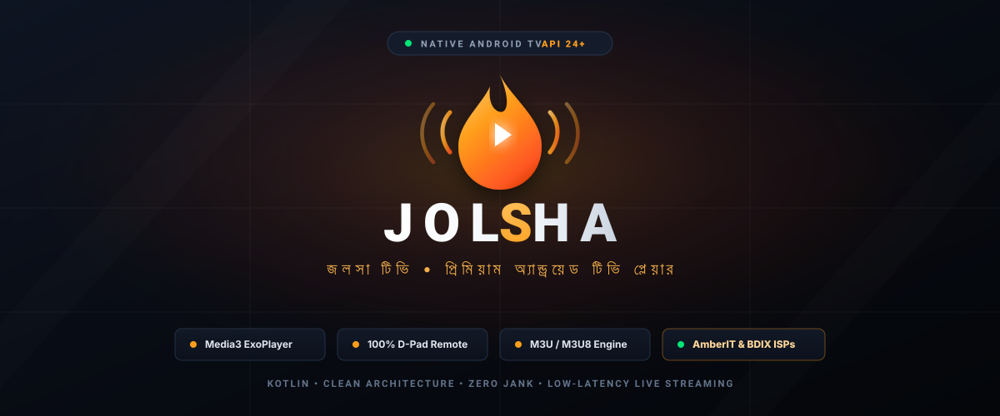

# Jolsha (জলসা) - Native Android TV IPTV Player

<p align="center">
  
</p>

<p align="center">
  
  
  
  
</p>

**Jolsha** is a premium, modern, lightweight native Android TV IPTV player built with Kotlin, native Android Views, and AndroidX Media3 ExoPlayer. Designed from the ground up specifically for large television displays and 100% remote control (D-pad) operation.

---

> [!IMPORTANT]
> **ISP & Network Compatibility Notice (Bangladesh)**  
> The default bundled playlist streams (such as `http://10.189.188.190:8080/...`) are internal local intranet broadcast streams that **only work on supported Bangladeshi ISPs** (including **AmberIT**, **Dot Internet**, **Carnival**, **Link3**, and other partner BDIX/IPTV networks).
> 
> If you are on an unsupported ISP, mobile data (GP, Robi, Banglalink, Teletalk), or outside Bangladesh, the default streams will not load. **You can load your own custom `.m3u` or `.m3u8` playlist at any time** via **Settings → Import M3U Playlist** using TV storage or a USB drive.

---

## 🌐 ISP & Network Compatibility

### Built-in IPTV Streams (Local ISP / BDIX)
The bundled channels connect to high-speed local intranet broadcast nodes in Bangladesh. These servers utilize private IP spaces (e.g., `10.189.188.190:8080`) to stream live TV with ultra-low latency and no international bandwidth usage:
- **Compatible ISPs**: **AmberIT**, **Dot Internet**, **Carnival Internet**, **Link3 Technologies**, and regional broadband providers with active IPTV / BDIX peering.
- **Incompatible Networks**: Mobile data operators (Grameenphone, Banglalink, Robi, Teletalk), non-peered broadband networks, or connections outside Bangladesh cannot route to these private IP addresses.

### Using Custom Playlists (Any ISP / Worldwide)
Jolsha is completely open and not locked to any single provider:
1. Place your own `.m3u` or `.m3u8` playlist file onto a USB flash drive or inside your TV's `Download` folder.
2. Launch Jolsha, navigate to the top-right **Settings** gear icon.
3. Select **Import M3U Playlist**.
4. Jolsha automatically parses, categorizes, caches, and remembers your channels across reboots.

---

## Key Features

### 📺 Cinematic Android TV Interface
- **Modern Obsidian & Amber Design**: High-contrast, dark cinematic theme (`#090C11` background, `#141A24` cards, and glowing electric amber `#FF9E1B` focus highlights).
- **100% Remote-Only D-Pad Usability**: Seamless navigation with clear, hardware-accelerated focus states (scale 1.05x, elevation rise).
- **Focus Memory**: Automatically remembers and restores the last focused channel position when returning from the player or switching categories.
- **Modern Wordmark Logo & TV Launcher Banner**: Custom geometric vector logo and 320x180 dp Android TV Leanback launcher banner.

### 📋 Robust M3U & M3U8 Playlist Engine
- **Flexible Attribute Parsing**: Full support for `tvg-id`, `tvg-name`, `tvg-logo`, `group-title`, and `#EXTGRP:`.
- **Category Grouping**: Smart categorization with system categories (*All Channels*, *Favorites*, *Recently Watched*) and playlist-defined groups.
- **Tolerant & Safe**: Gracefully handles irregular whitespace, single/double/unquoted attributes, BOM characters, and Unicode channel names (Bengali, Hindi, Arabic, etc.).
- **Multiple Import Sources**:
  - **Storage Access Framework (SAF)**: Import local `.m3u` or `.m3u8` files directly via system file picker.
  - **Local Storage Scanner**: Fallback auto-detection scans `Download` and `Documents` folders on Android TV devices lacking a system file picker.
  - **Local Persistence & Caching**: Efficient local caching and on-the-fly playlist reload without restarting the app.
- **Fast Search & Category Filtering**: Instant real-time filtering across channel names, TVG IDs, categories, and channel numbers.
- **Favorites & Watch History**: Remote-controlled favorite toggle (Long-press OK / Yellow key) and LRU Recently Watched list (capped at 30 items).

### ⚡ Media3 ExoPlayer Live Playback Engine
- **Optimized for Low-Powered TV Boxes**:
  - `DefaultLoadControl` tuned for fast live startup (`1500ms` buffer for playback, `2500ms` after rebuffer, `15s-30s` buffer window).
  - Decoder fallback enabled (`setEnableDecoderFallback(true)`) to prevent black screens on budget Android TV chipsets.
  - Custom User-Agent: `Jolsha-IPTV/1.0 (Android TV)`.
- **Stream Format Compatibility**: Handles HLS (`.m3u8`), MPEG-TS (`.ts` / raw HTTP TS), MP4, and HTTP progressive live streams.
- **MPEG-TS Keyframe Resilience**: Configured with non-IDR keyframe tolerance (`FLAG_ALLOW_NON_IDR_KEYFRAMES`) for glitch-free IPTV stream starts.
- **Aspect Ratio Modes**: Cycle seamlessly between **Original / Fit**, **Fill / Stretch**, **Zoom / Crop**, **16:9**, and **4:3**.
- **Audio Track Selection**: Multi-audio stream support with language labels and track selector modal.
- **Bounded Exponential Backoff**: Automatic retry up to 3 times (1s, 2s, 4s) with user-friendly offline status banners for unreachable private LAN streams.
- **In-Playback Quick Channel Guide**: Slide-in drawer allows browsing and switching channels with D-pad Up/Down without interrupting the current stream.
- **Channel Switching Shortcuts**: Dedicated support for remote Channel Up / Down keys and Previous Channel (Recall) button.
- **4-Second Auto-Hiding OSD**: Unobtrusive playback HUD that hides automatically during playback.

---

## Architecture & Technology Stack

| Component | Technology | Rationale |
|---|---|---|
| **Language** | Kotlin 2.0.21 | Modern, null-safe, coroutine-native |
| **UI Framework** | Android Views + Leanback | Minimum overhead, zero recomposition stutter, 100% stable TV D-pad focus |
| **Video Engine** | AndroidX Media3 ExoPlayer 1.5.1 | Industry-standard, low-latency live streaming, API 24+ compatible |
| **Image Loading** | Coil 2.7.0 | Lightweight coroutine-based logo loader with bounded 25% memory cache |
| **Architecture** | MVVM + Clean Architecture | Clear separation between data parsing, playback engine, and TV UI |
| **Async / Threading** | Kotlin Coroutines & StateFlow | Non-blocking background parsing on `Dispatchers.IO`, UI on `Dispatchers.Main` |
| **Min SDK** | Android 7.0 (API 24) | Compatible with older Android TV boxes |
| **Target SDK** | Android 15 (API 35) | Fully compliant with the latest Google Play & Android TV standards |

---

## Project Structure

```
D:\Projects\jolsha\
├── app\
│   ├── src\
│   │   ├── main\
│   │   │   ├── AndroidManifest.xml
│   │   │   ├── assets\
│   │   │   │   └── sample_playlist.m3u
│   │   │   ├── java\com\jolsha\tv\
│   │   │   │   ├── JolshaApp.kt
│   │   │   │   ├── data\
│   │   │   │   │   ├── model\ (Channel, Category, AspectRatio, PlaybackState, Playlist)
│   │   │   │   │   ├── parser\ (M3UParser)
│   │   │   │   │   └── repository\ (PlaylistRepository, UserPreferencesRepository)
│   │   │   │   ├── playback\ (PlayerManager, PlaybackListener, StreamSanitizer)
│   │   │   │   └── ui\
│   │   │   │       ├── common\ (FocusHighlightHelper)
│   │   │   │       ├── main\ (MainActivity, MainViewModel, adapters)
│   │   │   │       ├── player\ (PlayerActivity, PlayerViewModel, adapters)
│   │   │   │       └── settings\ (SettingsDialog, DeveloperDialog, AboutDialog)
│   │   │   └── res\
│   │   │       ├── drawable\ (ic_logo_jolsha, banner_jolsha, focus selectors)
│   │   │       ├── layout\ (activity_main, activity_player, item cards, dialogs)
│   │   │       ├── values\ (colors, dimens, strings, styles)
│   │   │       └── xml\ (network_security_config)
│   │   └── test\
│   │       └── java\com\jolsha\tv\ (M3UParserTest, PlaybackModelsTest, StreamSanitizerTest)
│   └── build.gradle.kts
├── art\
│   └── banner_jolsha.svg
├── gradle\
│   ├── libs.versions.toml
│   └── wrapper\
├── build.gradle.kts
├── settings.gradle.kts
├── playlist.m3u
└── README.md
```

---

## Remote Control Guide

| Action | Remote Key | Description |
|---|---|---|
| **Navigate** | D-pad Up / Down / Left / Right | Move focus across categories, channels, and controls |
| **Select / Play** | D-pad Center / OK / Enter | Open selected channel in fullscreen player |
| **Show / Hide HUD** | D-pad Center / OK (in player) | Toggle playback OSD controls |
| **Quick Channel Guide** | D-pad Up / Down (in player) | Open slide-in channel switcher during playback |
| **Next / Prev Channel** | Ch + / Ch - or D-pad Up / Down | Instant channel switching |
| **Toggle Favorite** | Long-press OK or Yellow Key | Add/remove channel to Favorites |
| **Cycle Aspect Ratio** | Aspect Key or On-screen button | Switch between Fit, Fill, Zoom, 16:9, 4:3 |
| **Back / Exit** | Back | Close drawer -> Hide HUD -> Return to channel grid |

---

## Building and Installing

### Prerequisites
- **JDK 17** (configured in `JAVA_HOME`)
- **Android SDK** (API 35 platform, Build-Tools 35.0.0 or 36.0.0)

### 1. Run Unit Tests
```bash
./gradlew testDebugUnitTest
```

### 2. Assemble APKs
- **Signed Release APK**:
  ```bash
  ./gradlew assembleRelease
  ```
  Generates production-signed APK at:
  ```
  app/build/outputs/apk/release/app-release.apk
  ```

- **Debug APK**:
  ```bash
  ./gradlew assembleDebug
  ```
  Generates debug APK at:
  ```
  app/build/outputs/apk/debug/app-debug.apk
  ```

### 3. Install on Android TV via ADB
Connect to your Android TV device via Wi-Fi or USB:
```bash
adb connect <TV_IP_ADDRESS>:5555
adb install -r app/build/outputs/apk/release/app-release.apk
```

---

## Network & Security Configuration
- **Cleartext HTTP Support**: Configured via `network_security_config.xml` with permissive base and local LAN rules (`10.x.x.x`, `192.168.x.x`, `172.16.x.x`, `localhost`) to support unencrypted private IPTV broadcast streams without TLS errors.
- **Privacy First**: All playlists, credentials, favorites, and watch history remain 100% local on the device without external telemetry.
- **Credential Masking**: Logs automatically sanitize and mask credentials from Xtream Codes URLs and session tokens.

---

## 👨‍💻 Developer & Credits
- **Lead Developer**: Mahatab Hossen Sudip (*Full Stack Developer*)
- **AI Coding Partner**: Claude
- **Contact**: [sudipmhx@gmail.com](mailto:sudipmhx@gmail.com)

---

## License
Built for personal and home entertainment on Android TV.
